<!-- # How to transfer your domain from your domain provider to Google cloud and set-up hosting for your webpage in 6 steps -->


AA
<!-- 
Assuming that you have already purchased your domain, for example on Namecheap, we will got through the five steps of how to transfer your domain name to Google Cloud and set-up a virtual machine instance to host your website on.

## Step 1 - Create Google Cloud account

Create your Google cloud account: https://cloud.google.com/free/docs/gcp-free-tier
and get $300 in free credit. 
You will have to add a credit card, but you will not be charged. 

**Note**: After 12 months, or if you spend all the $300, you will have to either convert to a paid account, or a free account. If you convert to a free account you will lose any compute instances you have running. 

## Step 2 - Set up Google Cloud project

Once your account is created, log on to the Google Cloud Platform (GCP) and click the icon on the right of the `Google Cloud Platform` logo. 

And the following window will appear:
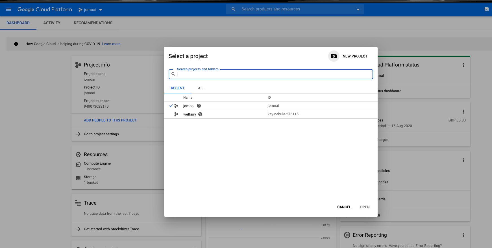

Click the new project button and type in your project name, i.e. the name of your website. For me that is `lunga`.
Add an organisation, if you have one (it doesn't matter if you don't) and 
then click `CREATE`. 

## Step 3 - Create a virtual machine  instance

We will now create a virtual machine (VM) instance. 
Think of a virtual machine as your desktop-pc, or laptop, but without a monitor. As that is all it is. 
It is machine with an operating system and compute resources that you can add files to, install programs on, run programs on, transfer files from etc.
You would typically use the terminal, or CMD prompt to work on the VM, although there are some graphical user interfaces out there for doing file transfers. Google cloud has a feature for doing this without the command line (allbeit, much less efficient than using the command line). We will see this in the latter steps. 


### Creating an instance

Ensure that your project is selected:
I.e. Lunga
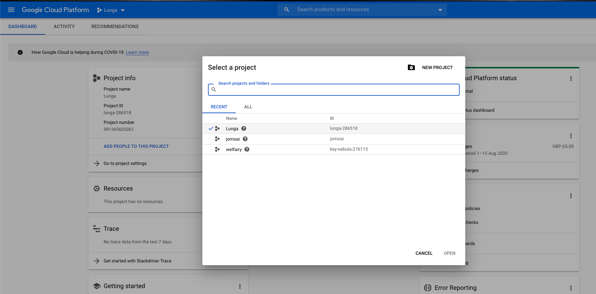

In the search bar on the GCP main page (in the blue header) type in `VM` and click `add VM instance`
 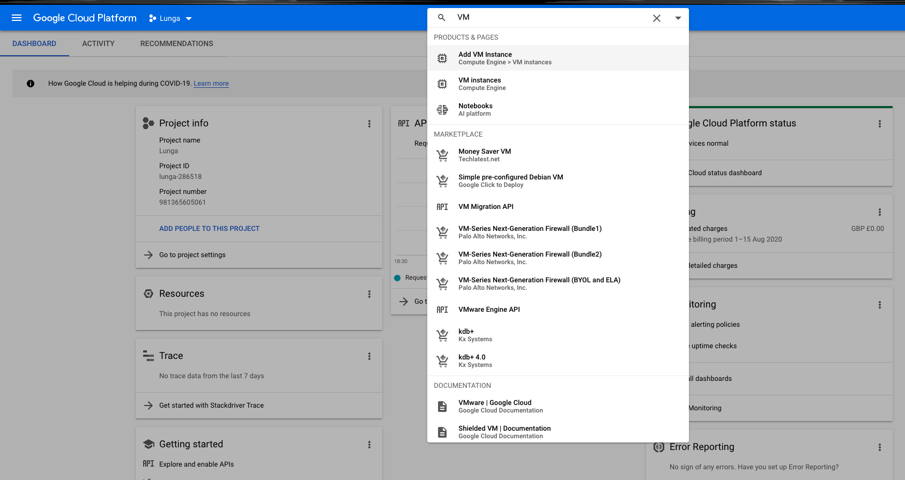

click `New VM Instance` it may take a little while to open the configuration screen, just be patient. 

Type in the instance name i.e. `lungaio` my domain name. You do not have to use your domain name here, but you will have to in latter steps. You could easily call it `my-webpage` or anything else within the given naming conventions. 

Select the right time region and zone.
When selecting an instance, it really depends on your requirements, if you are expecting a lot of traffic, ensure that you have the necessary requirements for that. If you are hosting a blog post, then a cheap instance should be okay. You can always update this at a later date by deleting this instance and creating a new one with a better specification. 
For me, I choose in the `series` drop down `E2`
and `machine type` drop down `e2-micro`. 
You get an approximate monthly cost for this on the right hand side - if it is used continually. 
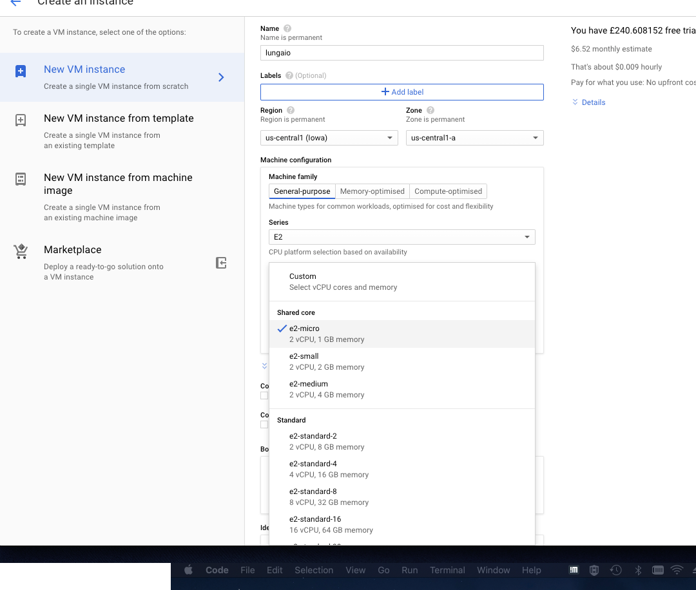

Next, select a boot disk (operating system). I choose `ubunutu`, version `20.04 LTS` as it is what I am comfortable with, but any GNU (Linux) based distribution will be fine. 

Set the GB size to whatever you think you'll need, I set mine to 20GB. 
Click `select`. 
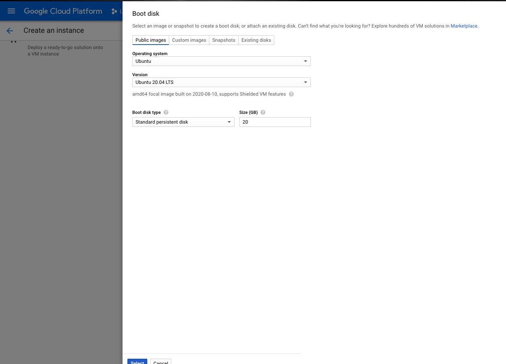

On the firewall settings add ticks to both options, as you want people to be able to visit your machine to view your website. 


There are a lot of other options, but for now, we will not touch those. 

Once you have completed the above, click the `Create` button. 
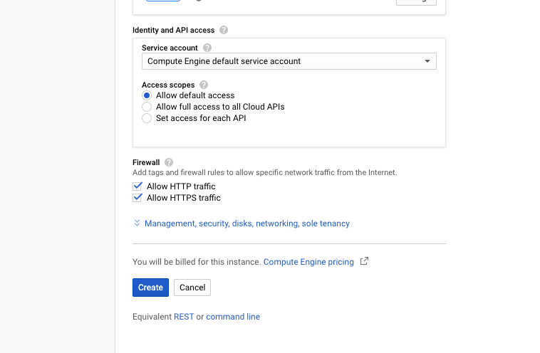

It will then create an instance and you should see the following. I'm falsifying my IPs. But, you will get a valid internal IP and an external IP. 
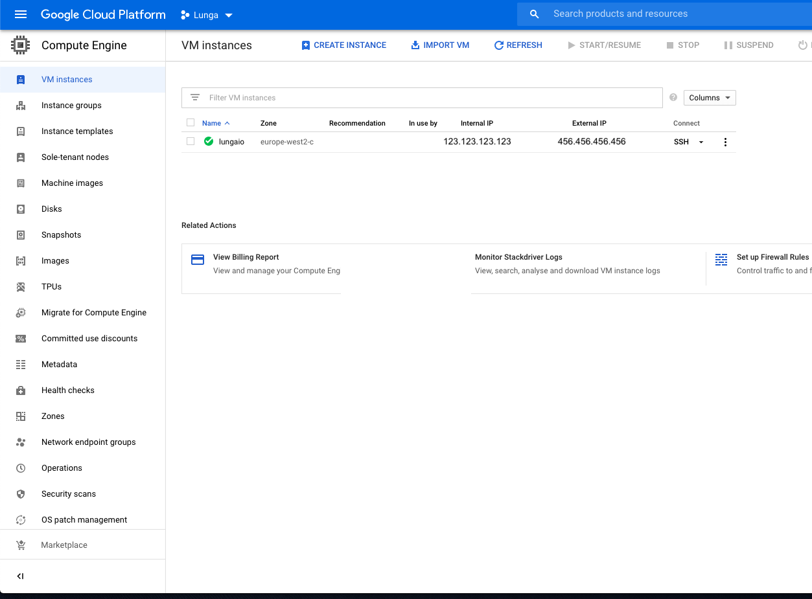

## Step 4 -  Creating a DNS on Google cloud to transfer your domain

On GCP, go to the search bar and type: `cloud dns`
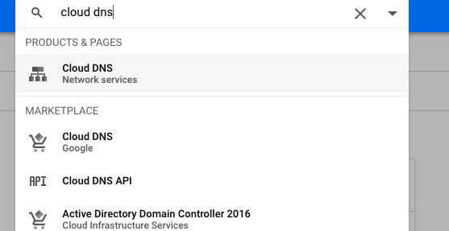
Click the create zone button.

Add your full domain name as the `name` for example `lungaio` and in the `DNS name` box add `lungo.io`.

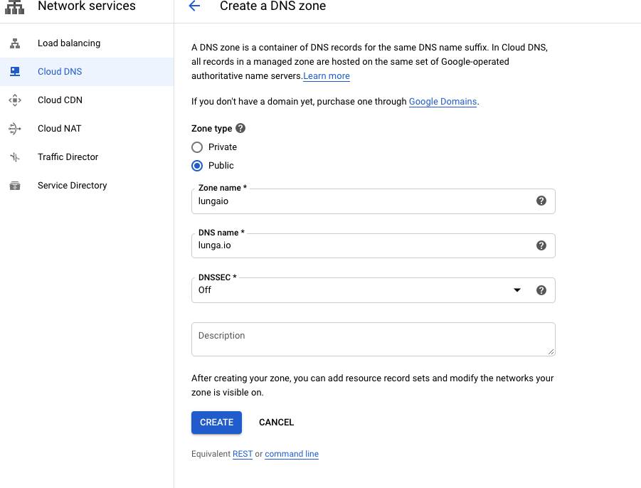

#### A short note on DNSSEC
For now, do not enable DNSSEC, but once you have transferred your domain to GCP your should set the setting to `on`. 
DNSSEC, the domain name system security extensions, protects the internet community from forged DNS data by using public key cryptography to digitally sign authoritative zone data when it comes into the system and then validate it at its destination. 
Digital signing helps assure users that the data originated from the stated source and that it was not modified in transit. DNSSEC can also establish that a domain name does not exist. These capabilities are essential to maintaining trust in the Internet.

More info is here: https://www.verisign.com/en_US/domain-names/dnssec/how-dnssec-works/index.xhtml


You can add a description, if you want, and then click `Create`.

You should see a page that looks similar to this (the black box is deliberately added by me):

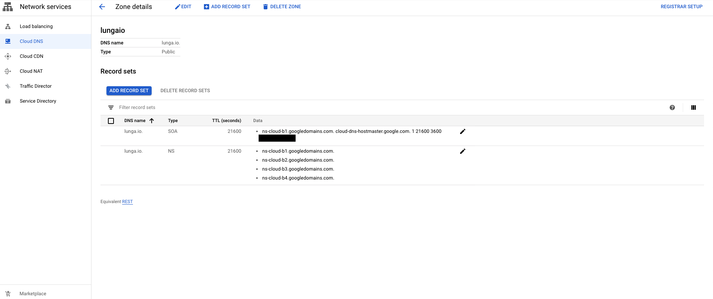

## Step 5: Transferring your domain

Log on to the provider you brought the name from, I brought mine from `namecheap.com`. 

Go on to your domain details page on your given provided, for example:
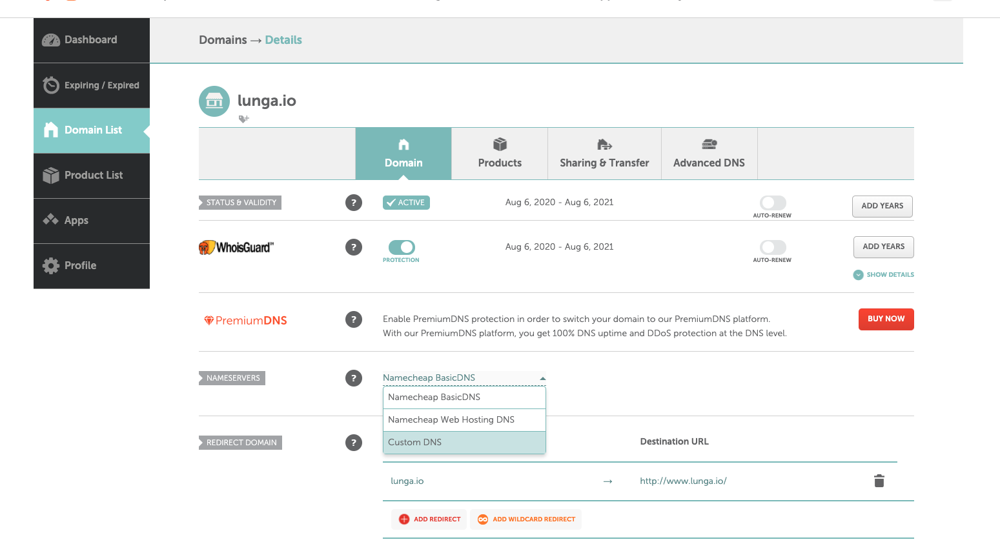

Locate the `DNS drop-down box`, or wherever you see `basicDNS`, `add custom DNS`, something along those lines. See above. It will be different between providers. 
On `namecheap` it is located in the `Nameservers` row. Select `custom DNS` (this will be the same among all providers). 

You will then have to input the DNS name servers:


Going back to the figure above the **Step 5** heading, you see:
```
ns-cloud-b1.googledomains.com.
ns-cloud-b2.googledomains.com.
ns-cloud-b3.googledomains.com.
ns-cloud-b4.googledomains.com.
```
Yours may be different. 

Go back to the `Cloud DNS` page on GCP and clicK `REGISTRAR SETUP` in the top right-hand corner. Then copy the domains and place one in each of the `nameserver` boxes. Since only the number changes here, you would only have to copy one, and then change the number in each box. You may need to add additional `nameserver` boxes in your domain provider. 


**Note**:The `.` is actually important, it provides information about the zone, so keep it. Not all people will see the `.`, it depends on your zone. 

Once this step is complete, everything will now be pointing to your GCP project, it can take up to 24 hours. We still have to create a bucket, but you should now be aware that your emails will no longer follow the definitions that you set on your domain purchasers site. So, you will have to update those. I will be writing another blog post explaining how to do that. 

## Step 6: Setting up a host for your webpage

We now head back to GCP and in the search bar, type `create bucket` and click `Create a Bucket`. 
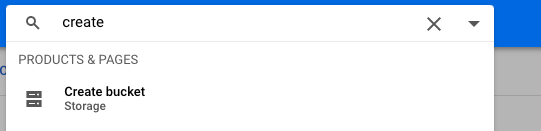

When naming your bucket, make sure your include your domain name and then click continue. 
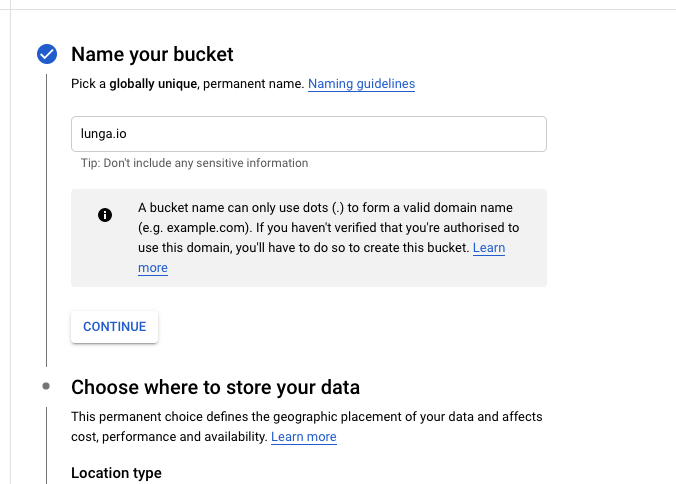

**Note**: You will have to go through a verification step to prove that it is your domain, I will show you how to do that in this step. 

You will see a grey information box appear, click `learn more`. 
Scroll down the page it takes you to and find the `Domain ownership verification` subsection. In that section click on the `Open Search Console` button:
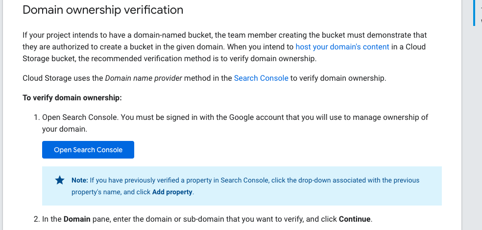

It will redirect you to the following page:
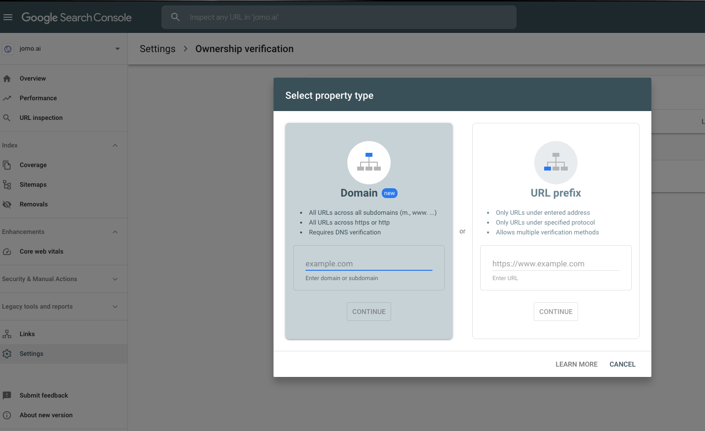
In the `Domain` box type in your domain name. You can add `www`, but you can also just add `lunga.io`:
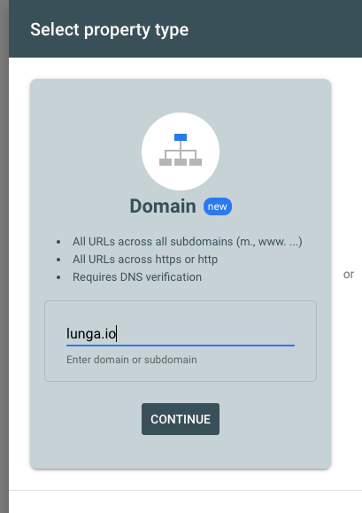

Then select continue and the following will appear:
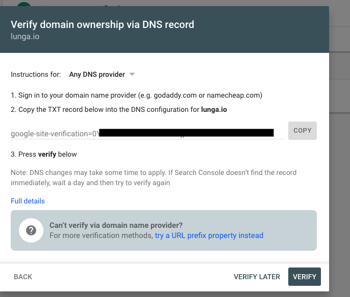
Ignore step 1 and copy the `TXT` record in the box. 

**Before** pressing `verify` open GCP in a new tab and keep the bucket creation page open in a tab. On your project page, which it should open automatically, go to the search box and type `Cloud DNS` and select it.

Click on your `zone name` that you created previously.
Once you are in the `zone detail` page, click the `ADD RECORD SET` button. 
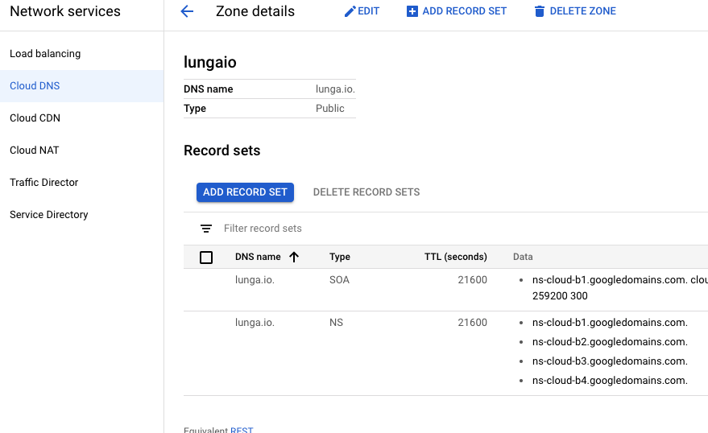

This will allow you to `Create record set`
Leave the DNS name box blank. 
In the `Resource record type` drop-down box select `TXT`. Set the `TTL` to 30
and the `TTL-unit` to `seconds`. This just tells Google how quickly to update the webpage. 

In the `TXT data` box, copy the verification code you copied. 

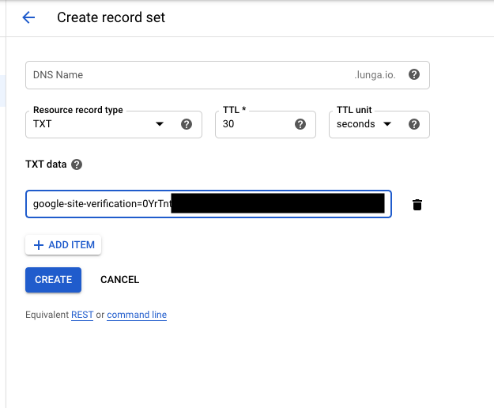

Then click the `CREATE` button.
This will now appear in your zone details. 
Head back to the verify page, wait approximately 30 seconds from the time you created the record and then click the `VERIFY` button. 

If it doesn't work, give it ten minutes or so, if it still doesn't work, give it longer. It can take up to 24 hours to transfer the DNS from your provider. 
You will see the following screen when the domain name has been transferred:
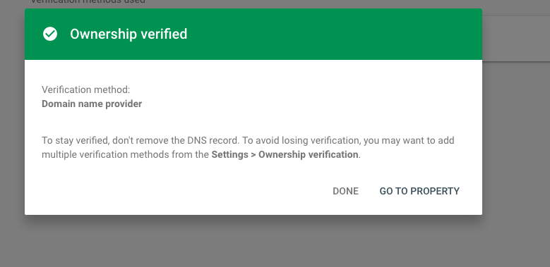
Then click `DONE`. 

Head back to your bucket creation and in the `Choose where to store your data` section, unless you have any specific requirements select `Multi-region` and your location. Then hit the `CONTINUE` button. 

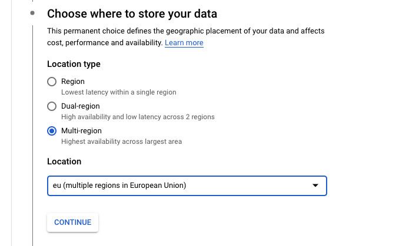

Then select the `Standard` storage option, unless your website will be doing other activities.
Click the `CONTINUE` button again. 

Then select the `Uniform` access control and hit `CONTINUE`. 

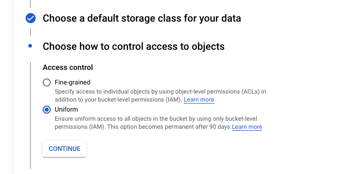
If you want more details about the different types of control, click the learn more hyperlinks.

Leave the `Encryption` on the `Google-manage key` unless you are comfortable with adding additional layers of security. 

Then click the `CREATE` button. 
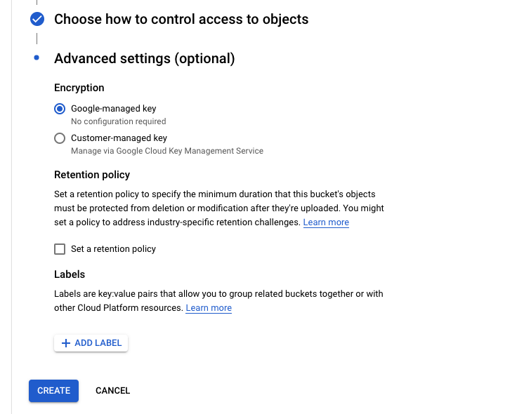

You will be taken to the page where you can now add the files for your webpage:
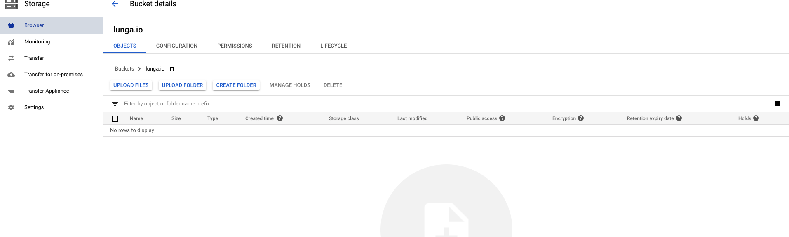

But, at the moment this doesn't know about your VM instance, so your website doesn't have any capacity for files. You can add files, but your website won't be able to host any traffic. 

Go back to your `VM` instance and copy the `External-IP` of the instance you created earlier.

Head back to the `Cloud DNS` page, go on to your `Zone details` that you created earlier and click the `ADD RECORD SET` button again. 

Leave the `DNS Name` blank and leave the `Resource record type` as `A`, as the VM instance will probably be `IPv4`, if it is `IPv6` select the record type to be `AAAA`. Set the `TTL` to be `1` and the `TTL unit` to `minutes. 
In the `Address` box copy your external IP. Then click the `CREATE` button. 
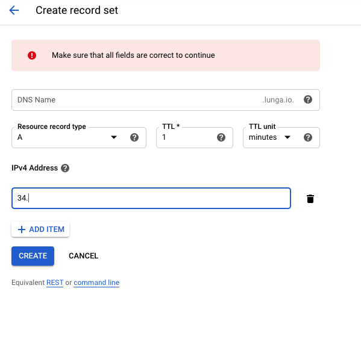

This will ensure that if people don't type the full address .i.e. `http://www.lunga.io`, or `https://www.lunga.io`, and just type `lunga.io` they will be redirected to the correct site. 
For safe measures, create another record set, of type `A`, or `AAAA` with the same external IP, but in the DNS box add `www` and then press `CREATE`.
You should now see something similar to the following:

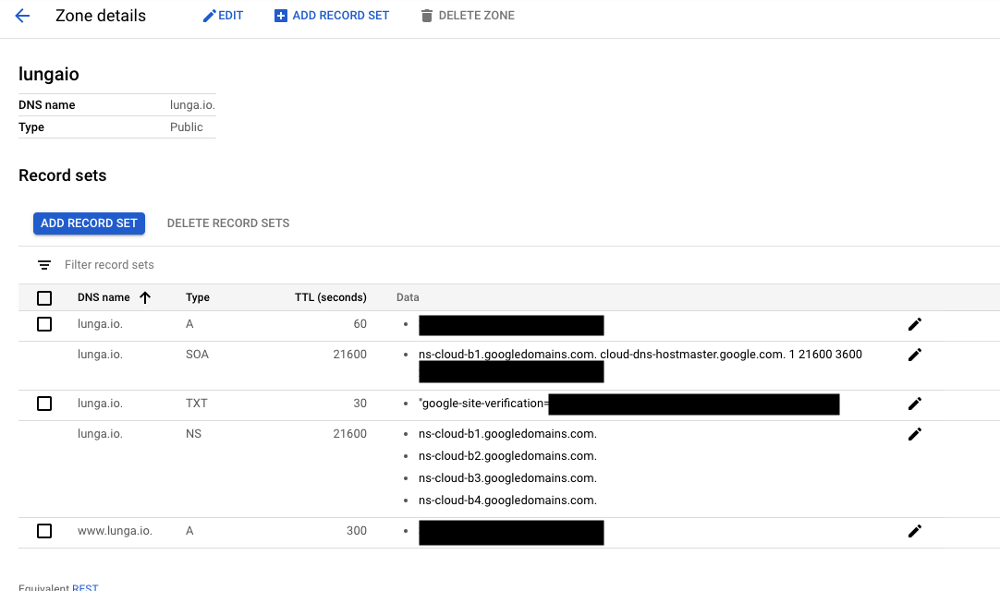

To check that your domain is now pointing at the VM instance in your terminal (UNIX systems) type:
```shell
dig lunga.io
```
and
```shell
dig www.lungo.io
```

You should see that they point to the instance IP:

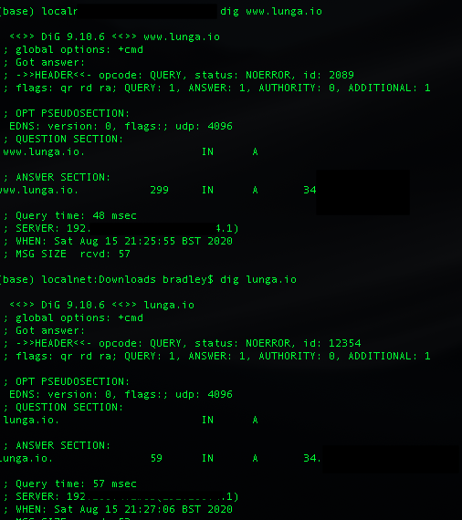

Now that everything is pointing to the right location, head back to your bucket page and start adding the website files. 

And that's it. You have migrated your domain to GCP and set-up an instance to host your website. 

That is all we will cover for now in this blog post, but in further blog posts we shall show how to set-up a Email service for the domain and how to set-up a simple static webpage. 

Thanks for reading and I hope this helps! -->